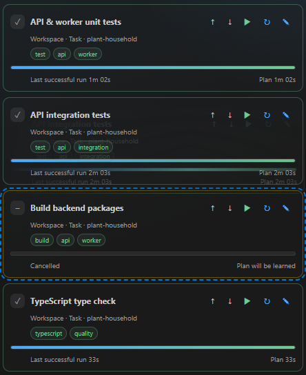

<p align="center">
  
</p>

<h1 align="center">Tasks Sidebar</h1>

<p align="center"><strong>A task board for your VS Code workspace.</strong></p>

<p align="center">
  Run builds, tests, and dev servers from the sidebar. See what is running, what failed, and how long the last successful run took.
</p>

<p align="center">
  <a href="https://github.com/ClemensSchmitt/tasks-sidebar/releases/latest"><strong>Download the latest VSIX</strong></a>
  · <a href="docs/manual/README.md">Read the handbook</a>
  · <a href="https://github.com/ClemensSchmitt/tasks-sidebar/issues">Report an issue</a>
</p>

<p align="center">
  
</p>

## What you can do

| | |
| --- | --- |
| **Run tasks from the sidebar** | Start, stop, and restart the tasks already defined in your VS Code workspace. |
| **See how a run is going** | Check status and elapsed time. The last successful run gives the progress bar a time estimate. |
| **Find a task quickly** | Search by name, provider, group, folder, or tags. Filter by status or switch on regex search. |
| **Keep frequent tasks within reach** | Drag cards into your preferred order or move them with the keyboard. The order is saved per workspace. |
| **Manage tasks where you run them** | Jump to a task's JSON definition or create a shell task for a folder or saved workspace. |

## Install and run your first task

Requires **VS Code 1.85 or newer**.

1. Download the `.vsix` from the [latest GitHub release](https://github.com/ClemensSchmitt/tasks-sidebar/releases/latest).
2. In VS Code, open the Extensions view and choose **Install from VSIX…** from the **…** menu.
3. Open a workspace with a `.vscode/tasks.json` file, select **Tasks** in the Activity Bar, and press **▶** on a task card.

### How tasks.json works

VS Code reads workspace tasks from `.vscode/tasks.json`. The file declares `"version": "2.0.0"` and a `tasks` array. Each entry has a `label` for its display name, a `type` such as `shell`, and the `command` and `args` to run. Tasks Sidebar adds an optional `tags` array for search and filtering. See the [VS Code guide to custom tasks](https://code.visualstudio.com/docs/debugtest/tasks#custom-tasks).

<details>
<summary>Copy the demo tasks.json from the screenshots</summary>

Save this as `.vscode/tasks.json` in a fresh workspace, or add the four entries to your existing `tasks` array. The demo uses Windows PowerShell to simulate task durations from 30 seconds to five minutes.

```json
{
  "version": "2.0.0",
  "tasks": [
    {
      "label": "TypeScript type check",
      "tags": ["typescript", "quality"],
      "type": "shell",
      "command": "powershell",
      "args": ["-NoProfile", "-Command", "Start-Sleep -Seconds 30"]
    },
    {
      "label": "API & worker unit tests",
      "tags": ["test", "api", "worker"],
      "type": "shell",
      "command": "powershell",
      "args": ["-NoProfile", "-Command", "Start-Sleep -Seconds 60"]
    },
    {
      "label": "API integration tests",
      "tags": ["test", "api", "integration"],
      "type": "shell",
      "command": "powershell",
      "args": ["-NoProfile", "-Command", "Start-Sleep -Seconds 120"]
    },
    {
      "label": "Build backend packages",
      "tags": ["build", "api", "worker"],
      "type": "shell",
      "command": "powershell",
      "args": ["-NoProfile", "-Command", "Start-Sleep -Seconds 300"]
    }
  ]
}
```

</details>

The board discovers workspace tasks automatically. Use **Tasks: Refresh** if the list is out of date. To show npm and other external task providers, run **Tasks: Toggle external task providers** or enable `tasksSidebar.includeExternalTasks`. Task output stays in VS Code's Terminal and Output panels.

## The sidebar in action

| Filter by tags | Reorder task cards |
| --- | --- |
| <br>Select tags to show tasks that match all of them. | <br>Drag cards into your preferred order. Tasks Sidebar saves it per workspace. |

| Search with regex | Open your task file |
| --- | --- |
| <br>Use the `.*` toggle to search with a regular expression. | <br>Use the pencil in the toolbar to open the workspace task file. |

## Compatibility and remote behavior

Local Windows, macOS, and Linux are covered by CI on VS Code 1.85.0 and Stable. WSL, Dev Containers, and Remote SSH are best effort. See the [compatibility guide](docs/manual/11-compatibility-remote.md) for details.

## Documentation

- [Discovery and task providers](docs/manual/02-discovery-providers-identities.md)
- [Running, stopping, and restarting tasks](docs/manual/03-execution-lifecycle.md)
- [Search, filters, tags, and sorting](docs/manual/05-search-filter-sort.md)
- [History and progress estimates](docs/manual/06-history-progress-persistence.md)
- [Commands, settings, and task files](docs/manual/07-commands-settings-tasks-json.md)
- [Keyboard controls and accessibility](docs/manual/10-accessibility.md)
- [Troubleshooting](docs/manual/09-troubleshooting.md)

## Development

```bash
npm install
npm run check
npm test
```

Press **F5** to open an Extension Development Host. Run `npm run test:extension` for the Extension Host suite, or `npm run package` followed by `npm run test:vsix` to verify an installed VSIX.

[Changelog](CHANGELOG.md) · [Support](SUPPORT.md) · [MIT License](LICENSE)
