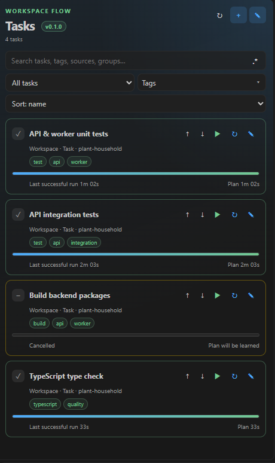
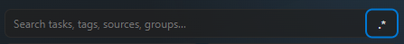

<div align="center">
  
  <h1>Tasks Sidebar</h1>
  <p><strong>Run your tasks. See where they stand.</strong></p>
  <p>A visual task board for VS Code. Start a build, rerun a test, and keep an eye on your dev server without leaving the editor.</p>
  <p><a href="https://github.com/ClemensSchmitt/tasks-sidebar/releases/latest"><strong>Download the VSIX ↗</strong></a> · <a href="#quickstart">Quickstart</a> · <a href="docs/manual/README.md">Handbook</a></p>
  <p><sub>VS Code 1.85+ · Windows, macOS, Linux · MIT</sub></p>
</div>

<p align="center">
  
</p>

## Run, track, and find tasks

- **Run, stop, and restart from the card.** See which tasks are active and how they ended.
- **Know what to expect.** Progress estimates use the duration of the last successful run.
- **Find the task you want.** Search by name, provider, folder, or tag and combine that with a status filter.

## Make the board yours

### Filter by tags

Select several tags to see tasks that match all of them.


### Reorder your tasks

Drag cards into place or move them with the keyboard. Your order is saved per workspace.


### Search with regex

Toggle `.*` to search with a JavaScript regular expression.



### Open task definitions

Use the pencil to open the task file, or the plus button to create a shell task.


## Quickstart

1. Download the `.vsix` from the [latest GitHub release](https://github.com/ClemensSchmitt/tasks-sidebar/releases/latest).
2. In VS Code, open the Extensions view and choose **Install from VSIX…** from the **…** menu.
3. Open your workspace, select **Tasks** in the Activity Bar, and press **▶** on a task card.

Already have a `.vscode/tasks.json`? The board discovers your workspace tasks automatically. Use **Tasks: Refresh** when you need to reload the list.

### How tasks.json works

VS Code uses `"version": "2.0.0"` and a `tasks` array. Each task has a display name (`label`), a `type` such as `shell`, and the `command` and `args` to run. Tasks Sidebar reads an optional `tags` array for search and filtering. [VS Code guide to custom tasks](https://code.visualstudio.com/docs/debugtest/tasks#custom-tasks)

<details>
<summary>Show the demo tasks.json from the screenshots</summary>

Save this as `.vscode/tasks.json` in a fresh workspace, or add the four entries to your existing `tasks` array. The demo uses Windows PowerShell to simulate task durations from 30 seconds to five minutes.

```json
{
  "version": "2.0.0",
  "tasks": [
    {
      "label": "TypeScript type check",
      "tags": ["typescript", "quality"],
      "type": "shell",
      "command": "powershell",
      "args": ["-NoProfile", "-Command", "Start-Sleep -Seconds 30"]
    },
    {
      "label": "API & worker unit tests",
      "tags": ["test", "api", "worker"],
      "type": "shell",
      "command": "powershell",
      "args": ["-NoProfile", "-Command", "Start-Sleep -Seconds 60"]
    },
    {
      "label": "API integration tests",
      "tags": ["test", "api", "integration"],
      "type": "shell",
      "command": "powershell",
      "args": ["-NoProfile", "-Command", "Start-Sleep -Seconds 120"]
    },
    {
      "label": "Build backend packages",
      "tags": ["build", "api", "worker"],
      "type": "shell",
      "command": "powershell",
      "args": ["-NoProfile", "-Command", "Start-Sleep -Seconds 300"]
    }
  ]
}
```

</details>

## Compatibility and remote behavior

| | |
| --- | --- |
| **npm and extension tasks** | Opt in with **Tasks: Toggle external task providers**. |
| **Task output** | Open VS Code’s Terminal or Output panel. |
| **Remote workspaces** | WSL, Dev Containers, and Remote SSH are best effort. See [compatibility details](docs/manual/11-compatibility-remote.md). |

## Explore the project

[Handbook](docs/manual/README.md) · [Changelog](CHANGELOG.md) · [Support](SUPPORT.md) · [MIT License](LICENSE)
