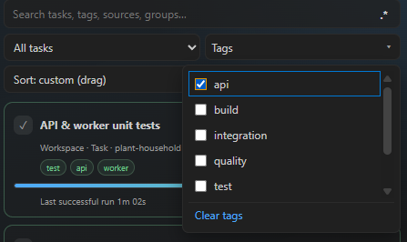
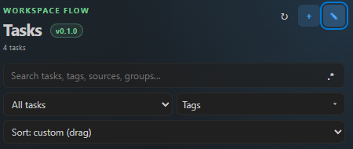

<div align="center">
  
  <h1>Tasks Sidebar</h1>
  <p><strong>Run your tasks. See where they stand.</strong></p>
  <p>A visual task board for VS Code. Start a build, rerun a test, and keep an eye on your dev server without leaving the editor.</p>
  <p><a href="https://github.com/ClemensSchmitt/tasks-sidebar/releases/latest"><strong>Download the VSIX ↗</strong></a> · <a href="#quickstart">Quickstart</a> · <a href="docs/manual/README.md">Handbook</a></p>
  <p><sub>VS Code 1.85+ · Windows, macOS, Linux · MIT</sub></p>
</div>

<p align="center">
  
</p>

<h2 align="center">Run, track, and find tasks</h2>

<p align="center"><strong>Run, stop, and restart from the card.</strong> See which tasks are active and how they ended.</p>
<p align="center"><strong>Know what to expect.</strong> Progress estimates use the duration of the last successful run.</p>
<p align="center"><strong>Find the task you want.</strong> Search by name, provider, folder, or tag and combine that with a status filter.</p>

<h2 align="center">Make the board yours</h2>

<h3 align="center">Filter by tags</h3>

<p align="center">Select several tags to see tasks that match all of them.</p>

<p align="center"></p>

<h3 align="center">Reorder your tasks</h3>

<p align="center">Drag cards into place or move them with the keyboard. Your order is saved per workspace.</p>

<p align="center"></p>

<h3 align="center">Search with regex</h3>

<p align="center">Toggle <code>.*</code> to search with a JavaScript regular expression.</p>

<p align="center"></p>

<h3 align="center">Open task definitions</h3>

<p align="center">Use the pencil to open the task file, or the plus button to create a shell task.</p>

<p align="center"></p>

<h2 align="center">Quickstart</h2>

<p align="center">1. Download the <code>.vsix</code> from the <a href="https://github.com/ClemensSchmitt/tasks-sidebar/releases/latest">latest GitHub release</a>.</p>
<p align="center">2. In VS Code, open the Extensions view and choose <strong>Install from VSIX…</strong> from the <strong>…</strong> menu.</p>
<p align="center">3. Open your workspace, select <strong>Tasks</strong> in the Activity Bar, and press <strong>▶</strong> on a task card.</p>

<p align="center">Already have a <code>.vscode/tasks.json</code>? The board discovers your workspace tasks automatically. Use <strong>Tasks: Refresh</strong> when you need to reload the list.</p>

<h3 align="center">How tasks.json works</h3>

<p align="center">VS Code uses <code>&quot;version&quot;: &quot;2.0.0&quot;</code> and a <code>tasks</code> array. Each task has a display name (<code>label</code>), a <code>type</code> such as <code>shell</code>, and the <code>command</code> and <code>args</code> to run. Tasks Sidebar reads an optional <code>tags</code> array for search and filtering. <a href="https://code.visualstudio.com/docs/debugtest/tasks#custom-tasks">VS Code guide to custom tasks</a></p>

<details>
<summary>Show the demo tasks.json from the screenshots</summary>

<p align="center">Save this as <code>.vscode/tasks.json</code> in a fresh workspace, or add the four entries to your existing <code>tasks</code> array. The demo uses Windows PowerShell to simulate task durations from 30 seconds to five minutes.</p>

```json
{
  "version": "2.0.0",
  "tasks": [
    {
      "label": "TypeScript type check",
      "tags": ["typescript", "quality"],
      "type": "shell",
      "command": "powershell",
      "args": ["-NoProfile", "-Command", "Start-Sleep -Seconds 30"]
    },
    {
      "label": "API & worker unit tests",
      "tags": ["test", "api", "worker"],
      "type": "shell",
      "command": "powershell",
      "args": ["-NoProfile", "-Command", "Start-Sleep -Seconds 60"]
    },
    {
      "label": "API integration tests",
      "tags": ["test", "api", "integration"],
      "type": "shell",
      "command": "powershell",
      "args": ["-NoProfile", "-Command", "Start-Sleep -Seconds 120"]
    },
    {
      "label": "Build backend packages",
      "tags": ["build", "api", "worker"],
      "type": "shell",
      "command": "powershell",
      "args": ["-NoProfile", "-Command", "Start-Sleep -Seconds 300"]
    }
  ]
}
```

</details>

<h2 align="center">Compatibility and remote behavior</h2>

<p align="center"><strong>npm and extension tasks</strong> Opt in with <strong>Tasks: Toggle external task providers</strong>.</p>
<p align="center"><strong>Task output</strong> Open VS Code’s Terminal or Output panel.</p>
<p align="center"><strong>Remote workspaces</strong> WSL, Dev Containers, and Remote SSH are best effort. See <a href="docs/manual/11-compatibility-remote.md">compatibility details</a>.</p>

<h2 align="center">Explore the project</h2>

<p align="center"><a href="docs/manual/README.md">Handbook</a> · <a href="CHANGELOG.md">Changelog</a> · <a href="SUPPORT.md">Support</a> · <a href="LICENSE">MIT License</a></p>
